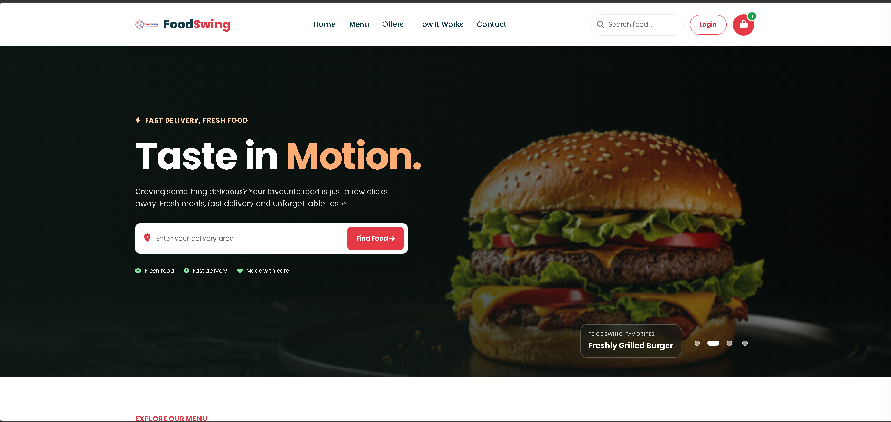

# FoodSwing: Taste in Motion

FoodSwing is a full-stack food ordering and delivery demo. Customers can explore
the menu, place Cash on Delivery orders, and follow order progress. Admins manage
orders and rider assignments, while riders handle deliveries through a dedicated
portal.

<p align="center">
  
</p>

## Features

### Customer experience

- Browse, search, sort, and filter food items by category.
- Add items to a cart and apply eligible promotion codes.
- Place orders with Cash on Delivery.
- Optionally share a map location at checkout and track an order.
- Register and sign in with a phone number and password.

### Admin dashboard

- Review orders and update their status.
- View an order's status and delivery history.
- Create and manage rider accounts.
- Check rider availability and assign eligible orders.

### Rider portal

- Create an account and sign in using a phone number and password.
- Set availability to online or offline.
- Review assigned deliveries and the customer's shared map location.
- Update delivery status and view completed delivery history.

## Technology

- **Frontend:** HTML, CSS, and vanilla JavaScript
- **Backend:** Node.js, Express
- **Database:** PostgreSQL
- **Authentication:** bcrypt password hashing and HTTP-only session cookies

## Requirements

- Node.js 20 or newer
- PostgreSQL 14 or newer

## Run locally

1. Clone the repository and enter the project:

   ```sh
   git clone https://github.com/AWPriyo/FoodSwing.git
   cd FoodSwing
   ```

2. Create a PostgreSQL database named `foodswing`.

3. Configure the backend environment. In PowerShell:

   ```powershell
   cd backend
   Copy-Item .env.example .env
   ```

   On macOS or Linux:

   ```sh
   cd backend
   cp .env.example .env
   ```

   Edit `.env` and set `DATABASE_URL` to your PostgreSQL connection
   string. The template includes the other local development settings. Use a
   strong `ADMIN_PASSWORD` of at least 12 characters for the initial admin
   setup.

4. Install dependencies, create the database schema and sample data, and
   provision the admin account:

   ```sh
   npm install
   npm run db:init
   npm run db:seed
   npm run db:admin
   ```

5. Start the server:

   ```sh
   npm start
   ```

6. Open [http://localhost:3000](http://localhost:3000).

The Express server serves both the frontend and API. Do not open the HTML files
directly from the filesystem.

After the admin account has been created successfully, remove `ADMIN_PASSWORD`
from `.env`; the running server does not need it. Never commit `.env` or
put real credentials in frontend files. For hosted deployment, configure
secrets in the hosting provider's environment settings and use a hosted
PostgreSQL database.

## Available scripts

Run these commands from the `backend` directory.

| Command | Description |
| --- | --- |
| `npm start` | Start the production server |
| `npm run dev` | Start the server in watch mode |
| `npm run db:init` | Create or update the database schema |
| `npm run db:seed` | Add or update sample products and promotions |
| `npm run db:admin` | Create or update the admin account |
| `npm test` | Run the backend test suite |

## Project structure

```text
FoodSwing/
├── backend/
│   ├── public/       # Customer frontend and public assets
│   ├── src/          # Express API, routes, database scripts and protected views
│   └── vercel.json   # Vercel function configuration
├── docs/
│   └── images/       # README screenshots
└── README.md
```

For API routes, order workflow details, and database notes, see
[backend/README.md](backend/README.md).

## Notes

- Cash on Delivery is the currently supported payment method. Online payments
  such as bKash or Nagad require a merchant payment-gateway integration.
- Promotion eligibility, prices, and delivery fees are recalculated by the
  server.
- Use a managed PostgreSQL database for deployment; a database running only on
  your computer is not accessible to a hosted application.


## Deploy to Vercel

1. Push this project to GitHub.
2. Import the repository into Vercel.
3. Set **Root Directory** to `backend`.
4. Keep the Framework Preset as **Other** (Vercel should detect the Express app from `src/app.js`).
5. Add `DATABASE_URL` (Neon pooled PostgreSQL connection string) and `DB_SSL=true` in Vercel Environment Variables.
6. Deploy. The contents of `backend/public/` are served as static assets by Vercel's CDN.

Initialize the Neon database from your local machine, using the same Neon connection string:
`npm run db:init`, then `npm run db:seed`, then `npm run db:admin`.
Set `ADMIN_EMAIL` and `ADMIN_PASSWORD` in your local `backend/.env` only while creating the admin account. Do not upload `.env` to GitHub or Vercel. For production, remove `ADMIN_PASSWORD` after the admin account is created.

Vercel detects the Express application exported from `src/app.js`; a separate `api/index.js` wrapper and catch-all rewrite are not required for this current Express deployment flow. Protected Admin and Rider HTML files are kept outside `public/` so they are only returned by the authenticated Express routes.
